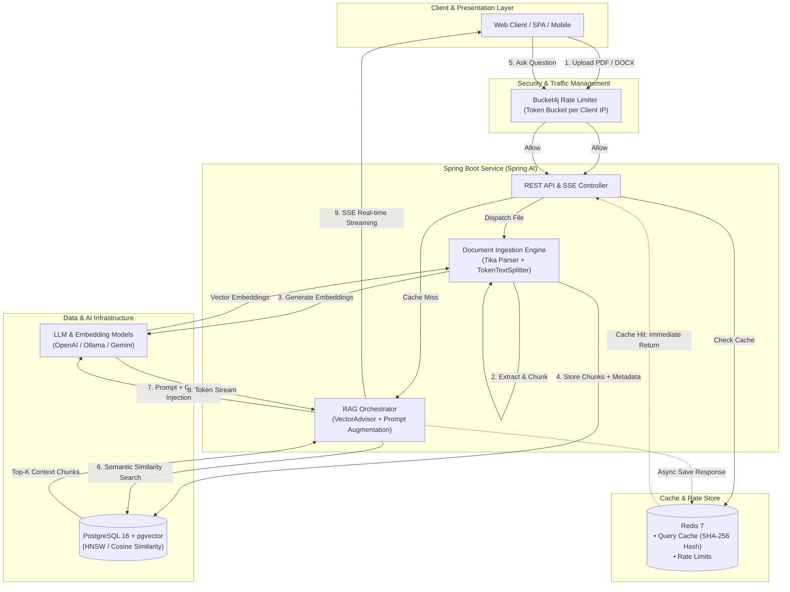

# 📄 AI Document Assistant (RAG Backend Service)

> 💡 *"vibe no brain ;v"* — Started as a portfolio flex, engineered into a serious high-performance RAG backend.

[](https://openjdk.org/)
[](https://spring.io/projects/spring-boot)
[](https://spring.io/projects/spring-ai)
[](https://github.com/pgvector/pgvector)
[](https://redis.io/)
[](https://www.docker.com/)

A production-grade, high-performance **Retrieval-Augmented Generation (RAG) Backend Service** designed to ingest complex multi-format documents (PDF, DOCX), generate high-dimensional vector embeddings, perform low-latency semantic search, and stream context-aware answers in real-time via **Server-Sent Events (SSE)**.

Hardened with **Redis Caching** to reduce LLM token consumption and **Bucket4j Rate Limiting** to protect against abuse and API quota exhaustion.

---

## 🏗️ System Architecture



---

## ✨ Key Features

- **Document Ingestion Pipeline**:
  - High-throughput parsing for multi-format documents (`.pdf`, `.docx`, `.txt`) using Apache Tika.
  - Smart semantic chunking via `TokenTextSplitter` (configurable chunk size & overlap window to retain contextual continuity).
  - Rich metadata enrichment (`document_id`, `filename`, `page_number`, `user_id`, timestamps) enabling strict multi-tenant isolation.
- **Semantic Search & Vector Storage**:
  - Vector storage backed by **PostgreSQL (`pgvector`)** utilizing HNSW indexing with Cosine Distance (`vector_cosine_ops`).
  - Strict similarity threshold filtering to prevent hallucinations from irrelevant context.
- **Real-Time Streaming Responses (SSE)**:
  - Non-blocking reactive streaming (`Flux<String>`) using **Server-Sent Events (`text/event-stream`)** for typewriter-style real-time outputs, minimizing Time-To-First-Token (TTFT < 800ms).
- **Two-Tier Performance & Cost Optimization (Redis)**:
  - **Query Caching**: Hashes normalized prompts and document scopes in Redis to serve identical questions instantly (< 10ms) without invoking the LLM, reducing API costs by 30-40%.
  - **User-Level Rate Limiting**: Distributed token-bucket algorithm using **Bucket4j** to enforce per-IP / per-client rate limits (e.g., 10 req/min).
- **Built-in PoC Web Client**:
  - Embedded zero-dependency web interface located in `src/main/resources/static/index.html` featuring drag-and-drop file upload, real-time streaming chat, and cache hit/miss badges.

---

## 🛠️ Tech Stack

| Component | Technology | Purpose |
| :--- | :--- | :--- |
| **Language** | Java 21 LTS | Records, Pattern Matching, Virtual Threads |
| **Framework** | Spring Boot 3.3+ / 4.x | Core Microservice Framework |
| **AI Abstraction** | Spring AI | VectorStore, ChatClient, Document Readers |
| **Vector DB** | PostgreSQL 16 (`pgvector`) | High-dimensional embedding storage & HNSW search |
| **Cache & Limiting** | Redis 7 + Bucket4j | Response caching & IP token-bucket rate limiter |
| **Document Parsers** | Apache Tika / PDFBox | Multi-format text extraction |
| **Containerization** | Docker, Docker Compose | Automated local & production deployment |

---

## 🚀 Quick Start

### 1. Prerequisites
- **Java 21** or higher
- **Docker & Docker Compose**
- **OpenAI API Key** (or local **Ollama** instance)

### 2. Infrastructure Setup (Docker Compose)
Launch PostgreSQL (with `pgvector`) and Redis in the background:
```bash
cd be
docker compose up -d
```

Verify that the containers are healthy:
```bash
docker ps
# Expected: pgvector (port 5432) and redis (port 6379) running
```

### 3. Configure API Keys
Set your LLM API Key in environment variables or `be/src/main/resources/application.yaml`:
```bash
export SPRING_AI_OPENAI_API_KEY="sk-your-openai-api-key"
```

### 4. Build and Run the Application
```bash
cd be
./mvnw clean spring-boot:run
```
The service will start on `http://localhost:8080`.

---

## 📖 API Documentation

### 1. Ingest Document
Upload a document (`PDF`, `DOCX`, or `TXT`) for chunking and vectorization.

```bash
curl -X POST http://localhost:8080/api/v1/documents/upload \
  -H "X-User-Id: user_001" \
  -F "file=@sample_policy.pdf"
```

**Response (200 OK):**
```json
{
  "documentId": "a93df530-3882-4bf5-b541-11883c74c0b4",
  "filename": "sample_policy.pdf",
  "totalChunks": 24,
  "status": "INGESTED_SUCCESSFULLY"
}
```

---

### 2. Stream Question & Answer (SSE)
Query the knowledge base with real-time word-by-word streaming response.

```bash
curl -N -X GET "http://localhost:8080/api/v1/chat/stream?prompt=What%20is%20the%20remote%20work%20policy?" \
  -H "X-User-Id: user_001" \
  -H "Accept: text/event-stream"
```

**Stream Output:**
```text
data: According
data:  to
data:  the
data:  document,
data:  employees
data:  may
data:  work
data:  remotely
data:  up
data:  to
data:  3
data:  days
data:  per
data:  week.
```

---

## 🖥️ Live Demo UI

Open your browser at `http://localhost:8080` to access the built-in demo interface:
- Drag-and-drop document upload with real-time status.
- Word-by-word typewriter streaming output.
- Cache hit/miss indicator badges.

---

## 📂 Project Structure

```text
ai-document-assistant/
├── be/                                # Backend Spring Boot Service
│   ├── compose.yaml                  # Postgres (pgvector) + Redis container definitions
│   ├── pom.xml                       # Maven dependencies & build lifecycle
│   └── src/
│       ├── main/
│       │   ├── java/com/assistant/rag/
│       │   │   ├── config/           # AI, VectorStore, Redis & RateLimit configs
│       │   │   ├── controller/       # Ingestion & Streaming Chat APIs
│       │   │   ├── service/          # Ingestion, RAG, and Cache business logic
│       │   │   ├── model/            # DTOs, Enums, and Records
│       │   │   └── exception/        # Centralized exception handling
│       │   └── resources/
│       │       ├── application.yaml  # App configurations & vector dimensions
│       │       └── static/index.html # Embedded Demo Web UI (Tailwind CSS)
├── PLAN.md                           # Milestone & Implementation Roadmap
└── README.md                         # Project documentation
```

---

## 👨‍💻 Author
- **GitHub**: [@HuyHoang2277](https://github.com/HuyHoang2277)
